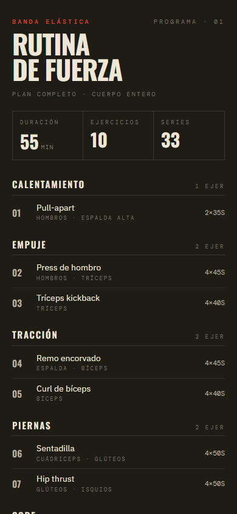
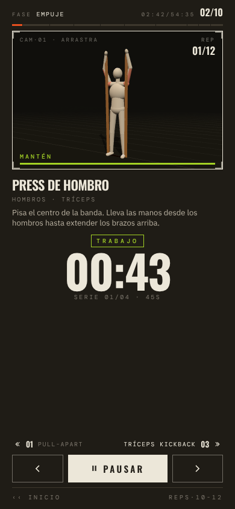

# Rutina de Fuerza con Elásticos

Strength-training routine app for **flat open resistance bands** (therapy bands — long flat strips, no handles). Designed to train the major muscle groups and help maintain endurance. UI is in Spanish.

Every exercise is rendered in 3D with an articulated mannequin animated in real time: quaternion interpolation, foot IK so feet stay planted, a training tempo (fast concentric, slow eccentric) synced to the routine's reps, and a flat band simulated with Verlet physics whose color shifts lime → red as it stretches.

<p>
  
  &nbsp;
  
</p>

## Stack

- **Vite 6** + **React 19**
- **Tailwind CSS v4** (via `@tailwindcss/vite`)
- **Three.js** (scene built by hand, no `OrbitControls`)
- **Bun** as runtime and package manager

## Commands

```bash
bun install        # install dependencies
bun run dev        # dev server at http://localhost:5173
bun run build      # production build to dist/
bun run preview    # serve the built bundle
```

## Structure

```
src/
├── data/
│   ├── poses.js         # poses as flat dicts of joint angles (radians)
│   ├── exercises.js     # exercises: keyframes, tempo, cues, camera, band config
│   └── routine.js       # ordered routine (sets, work, rest, reps, phase)
├── animation/
│   ├── easing.js        # cubic-bezier easings (concentric / eccentric)
│   ├── tempo.js         # rep plan: tempo scaled so reps fill the work time
│   └── director.js      # workout phase + elapsed time → poses to show + HUD
├── state/
│   └── workoutReducer.js  # state machine work → rest → … → complete
├── three/
│   ├── skeleton.js      # mannequin construction (joints, meshes, colliders)
│   ├── rig.js           # quaternion poses, slerp blending, two-bone IK
│   ├── bandRenderer.js  # Verlet band simulation + flat ribbon meshes
│   ├── cameraRig.js     # orbit camera with per-exercise framing
│   └── exerciseScene.js # scene, lights, crossfades, secondary motion
├── components/
│   ├── StartScreen.jsx
│   ├── WorkoutScreen.jsx
│   ├── CompleteScreen.jsx
│   ├── ExerciseViewer.jsx  # React wrapper of the 3D scene + rep HUD
│   └── viewerLoader.js  # lazy-loads the viewer (Three.js) in a separate chunk
├── dev/
│   └── PoseLab.jsx      # dev-only pose editor (`bun run dev` → `?lab`)
├── App.jsx              # routing via reducer flags + 100ms tick
└── main.jsx
```

Three layers: **data → engine → UI**. Adding an exercise touches all three but is mostly data work.

## Supported band types

Each exercise declares a `band.type`:

- `handToHand` — single segment between the two hands.
- `footToHand_dual` — the middle is stepped on; one segment per side (foot → hand).
- `overhead_to_feet` — single segment from mid-hands to mid-feet.
- `oneFoot_to_handMid` — one foot steps on an end, both hands hold the other.
- `handToHand_overHip` — crosses over the hips, each end held by a hand.
- `anchored_side` — fixed anchor mesh + segment to mid-hands. Requires `anchorPos: [x, y, z]`.

The natural length is computed automatically (`minStretch` = how taut the band is at its loosest keyframe) unless `naturalLength` is given.

## Adding an exercise

1. Define start/end poses in `src/data/poses.js` (use the `d()` helper for degrees → radians; keep the joint key set consistent). Tune them live in the Pose Lab (`bun run dev`, open `/strength-routine/?lab`) and copy the result.
2. Add an entry to `EXERCISES` with `keyframes` (usually `[start, end, start]`), a valid `band` config, and optionally `tempo`, `concentric`, `cues`, `works`, `camera`, `restPose`, `plantHands` / `handPath`.
3. Append a row to `ROUTINE` with `sets`, `workSec`, `restSec`, `reps`, and `phase` (free-form Spanish string used to group exercises on the start screen). The animation tempo adapts so the reps fill `workSec`.

If a movement needs a new pose shape, prefer extending an existing pose rather than duplicating — many poses are shared across exercises.

## Language

All user-facing copy in the app is in Spanish, it is intended for Spanish-speaking users.
